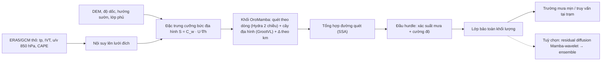

# State Space Models (SSM) cho Downscaling Lượng mưa

## Khảo sát các paper tiềm năng (chưa được khai thác) và đề xuất hướng nghiên cứu

> **Ngày khảo sát:** 05/11/2026
> **Phạm vi:** họ SSM hiện đại (S4 → Mamba-3) cùng các biến thể cho thị giác, mô hình sinh, không–thời gian và neural operator.
> **Mục tiêu:** tìm các paper SSM *hay, nổi tiếng, có tiềm năng* nhưng **chưa được áp dụng** cho downscaling lượng mưa, phân tích chúng và đề xuất ý tưởng áp dụng.

---

## 0. Tóm tắt nhanh

1. **Khoảng trống còn rất lớn.** Trong downscaling khí tượng, công trình SSM duy nhất tìm được là **MambaDS** (Liu et al., 2024). Mô hình này quét 2D theo 4 hướng kiểu VMamba, thêm 1 đường quét *xáo trộn ngẫu nhiên*, dùng channel attention giữa các biến và một lớp ràng buộc địa hình ở đầu ra (DEM ETOPO). Tập biến ERA5 của họ có `tp1h` (mưa 1 giờ), nhưng mô hình không được thiết kế riêng cho mưa. Các công trình Mamba khác về mưa (MambaRain, STVMamba, TransMambaCNN, RadarEchoMamba, PredUMamba, VMU-Diff) đều làm **nowcasting**, không làm downscaling.
2. **Chưa thấy ai dùng cho downscaling mưa** (theo khảo sát này) các nhóm sau:
   - SSM liên tục, bất biến độ phân giải (S4ND, S³Mamba);
   - SSM hai chiều có nền tảng lý thuyết (Hydra, Mamba-2/SSD) và Mamba-3;
   - các chiến lược quét thông minh (GrootVL, QuadMamba, 2DMamba, MaIR);
   - SSM khôi phục ảnh thế hệ mới (MambaIRv2) và SSM hợp nhất đa nguồn (Pan-Mamba);
   - SSM làm backbone diffusion (DiffuSSM, DiMSUM);
   - SSM không–thời gian (ConvSSM), SSM–neural operator (LaMO) và SSM xác suất (KalMamba).
3. **Ý tưởng mạnh nhất (vừa mới, vừa có cơ sở vật lý): OroMamba.** Cho SSM quét **theo hướng dòng ẩm/gió** và khởi tạo tham số từ **lý thuyết tuyến tính mưa địa hình của Smith & Barstad (2004)**. Phần "ngưng tụ – rơi có trễ" của lý thuyết này *chính là* một SSM tuyến tính 2 trạng thái dọc đường dòng. Trong đó bước rời rạc Δ = Δs/|U| phụ thuộc đầu vào, đúng với cơ chế *selective* của Mamba (xem mục 5).
4. **Hai hướng tiếp theo:**
   - **Downscaling không phụ thuộc độ phân giải:** Δ tính theo km, kết hợp S4ND + S³Mamba + bộ giải mã ẩn (INR).
   - **SSM-diffusion ở km-scale:** dùng DiMSUM/DiffuSSM làm denoiser cho residual diffusion kiểu CorrDiff, kèm lớp bảo toàn khối lượng.
5. **Điểm khởi đầu an toàn:** một benchmark có kiểm soát *"thứ tự quét có quan trọng với mưa không?"* trên RainShift (ERA5→IMERG) cộng dữ liệu Việt Nam. **Lưu ý:** MambaDS báo cáo VMambaIR (Mamba "thuần" cho SR) **kém hơn CNN** trên ERA5. Vậy SSM không tự động tốt hơn; lợi thế phải đến từ thiết kế theo đặc thù miền.

---

## 1. Đặc thù của downscaling lượng mưa và yêu cầu với kiến trúc

| # | Đặc thù vật lý/thống kê | Hệ quả cho mô hình | Tính chất SSM có thể khai thác |
|---|---|---|---|
| 1 | **Gián đoạn và đuôi dày**: phần lớn ô lưới khô ở bước giờ; cực trị quyết định thiệt hại | Loss MSE gây mờ và đánh giá thấp cực trị; cần loss xác suất/hurdle | Cơ chế chọn lọc Δ (giữ hay quên trạng thái) có thể được gán nghĩa "mưa/không mưa" (Ý tưởng 5) |
| 2 | **Đa tỉ lệ**: phổ công suất giảm theo luật lũy thừa | Mô hình hồi quy bị *spectral bias* (mất năng lượng tần cao) | Quét trong miền wavelet/tần số (DiMSUM); kernel liên tục có kiểm soát băng thông (S4ND) |
| 3 | **Địa hình và hướng gió**: mưa sườn đón gió, bóng mưa sườn khuất gió, cực đại mưa trôi xuôi gió | Ảnh hưởng địa hình *có hướng* và phụ thuộc trạng thái khí quyển | Trạng thái đệ quy theo thứ tự quét, nên có thể quét **theo dòng** (Ý tưởng 1) hoặc theo cây địa hình (GrootVL) |
| 4 | **Phụ thuộc xa**: vận chuyển ẩm, gió mùa, dải mưa xoắn của bão | Cần trường tiếp nhận toàn cục | Tầm nhìn toàn cục với độ phức tạp tuyến tính |
| 5 | **Miền lớn ở km-scale** (Việt Nam ở 1 km cỡ 10⁶ ô) | Attention O(N²) không khả thi; cắt tile gây "đường nối" | O(N) cho phép xử lý cả miền một lần |
| 6 | **Nhiều tỉ lệ, nhiều nguồn**: CMIP6 ~100 km, ERA5 25 km, CORDEX 25/12 km, đích 1–5 km hoặc trạm | Mô hình cố định ×4/×8 phải train lại cho mỗi cặp | SSM là hệ liên tục được rời rạc hoá bằng Δ: đổi độ phân giải tức là đổi Δ (S4ND, S³Mamba) |
| 7 | **Nhất quán thời gian, chu kỳ ngày**, tổng mưa giờ phải bằng tổng ngày | Downscale từng khung gây "nhấp nháy" và sai pha chu kỳ ngày | SSM vốn là mô hình chuỗi; trạng thái phức (Mamba-3) biểu diễn dao động |
| 8 | **Bất định**: cần ensemble và CRPS | Mô hình tất định không đủ | SSM làm backbone cho diffusion; SSM xác suất (KalMamba) |
| 9 | **Bảo toàn**: trung bình khối của trường mịn phải khớp trường thô; giá trị không âm | Cần ràng buộc cứng ở đầu ra | Gắn được lớp ràng buộc kiểu Harder et al. (2023) sau mọi backbone |
| 10 | **Dịch chuyển phân phối** (vùng mới, khí hậu tương lai) | Hiệu năng giảm mạnh ngoài miền huấn luyện (RainShift) | Quy nạp vật lý (Ý tưởng 1) có thể giúp tổng quát hoá tốt hơn |

---

## 2. Kiến thức nền tối thiểu (để đọc phần ý tưởng)

SSM liên tục:

$$h'(t) = A\,h(t) + B\,x(t),\qquad y(t) = C\,h(t) + D\,x(t)$$

Rời rạc hoá kiểu zero-order hold (ZOH) với bước Δ:

$$\bar A = e^{\Delta A},\quad \bar B = (\Delta A)^{-1}\big(e^{\Delta A}-I\big)\,\Delta B,\quad h_k = \bar A\, h_{k-1} + \bar B\, x_k,\quad y_k = C\, h_k$$

- **S4, S4D, S5 (LTI):** A, B, C, Δ cố định, nên tương đương một tích chập toàn cục (tính bằng FFT).
- **Mamba (selective):** Δ, B, C là hàm của đầu vào x_k.
  - Δ nhỏ: $\bar A \approx I$, x_k gần như bị bỏ qua, trạng thái được giữ nguyên.
  - Δ lớn: trạng thái cũ bị quên, mô hình tập trung vào x_k.
- **Ảnh 2D phải được "duỗi" thành chuỗi.** Vì vậy *thứ tự quét* quyết định ô nào "nhìn thấy" ô nào, và với độ suy giảm bao nhiêu. Đây là điểm mấu chốt mà phần lớn đề xuất bên dưới khai thác.
- **Mamba-2/SSD:** viết lại SSM chọn lọc thành phép nhân với ma trận *bán tách được* (semiseparable), nên huấn luyện nhanh bằng matmul và cho phép trạng thái lớn hơn.

---

## 3. Hiện trạng: SSM đã được dùng ở đâu cho mưa và khí tượng

| Công trình | Bài toán | Kiến trúc SSM | Ghi chú |
|---|---|---|---|
| **MambaDS** (Liu et al., arXiv 2408.10854, 2024) | **Downscaling** trường khí tượng bề mặt. ERA5 (làm thô rồi phục hồi): u10, v10, sp, t2m, tp1h; HRRR. Miền Trung Quốc và CONUS | 5D-SSM: 4 hướng quét kiểu VMamba + 1 đường xáo trộn ngẫu nhiên; channel attention; lớp ràng buộc địa hình (DEM ETOPO) | *Công trình SSM-downscaling duy nhất* tìm được. Baseline VMambaIR kém CNN trên ERA5 |
| MambaRain (arXiv 2605.14606, 2026) | Nowcasting 0–3 h (radar SWAN) | Mamba (thời gian) + self-attention (không gian); DEM; spectral loss | Tất định |
| STVMamba (Sci. Rep., 2025) | Nowcasting | Mamba không–thời gian | |
| TransMambaCNN (Remote Sens., 2025) | Dự báo mưa ngắn hạn | Mô-đun state-space tích chập + Transformer + CNN | |
| RadarEchoMamba (Remote Sens., 2026) | Ngoại suy phản hồi radar | Mamba không–thời gian hai chiều, dạng kim tự tháp | |
| PredUMamba (JEIT) | Nowcasting vùng địa hình phức tạp | Diffusion + Mamba quét zigzag thích nghi | |
| VMU-Diff (arXiv 2605.14597, 2026) | Nowcasting từ radar + vệ tinh | Vision-Mamba U-Net (giai đoạn thô) + residual diffusion (giai đoạn mịn) | Gần với Ý tưởng 3 nhưng là nowcasting |
| MetMamba (2024), WSSM (2025), RiverMamba (2025) | Dự báo thời tiết khu vực / tại trạm / lưu lượng sông | Mamba | Không phải downscaling |

**Các mốc so sánh không dùng SSM** cho downscaling mưa:
- **CorrDiff:** residual diffusion, ERA5 25 km → 2 km.
- **STVD:** video diffusion, NeurIPS 2024.
- **WDM:** wavelet diffusion 10 km → 1 km trên MRMS, nhanh hơn 9× so với diffusion trong miền điểm ảnh.
- **SpLIIF:** INR, tỉ lệ tùy ý, cho nhiệt độ và gió.
- **RainShift:** benchmark tổng quát hoá địa lý ERA5 → IMERG.

**Bài học rút ra**
1. Quét cố định theo hàng/cột (hoặc quét ngẫu nhiên) không có nghĩa vật lý. Chưa ai "dạy" SSM *quét theo dòng khí*. Ý tưởng sắp xếp patch theo gió mới thấy ở một mô hình Transformer cho chất lượng không khí (TopoFlow); quét Hilbert 3D có ở FH-Mamba (băng biển).
2. Địa hình mới được dùng như kênh đầu vào hoặc trọng số hậu kỳ, chưa đi **vào bên trong** phương trình trạng thái (Δ, A, B).
3. Chưa có SSM liên tục/bất biến độ phân giải, SSM sinh hay SSM không–thời gian cho *downscaling*.
4. Mamba "nguyên bản" không tự động thắng CNN (MambaDS; MambaOut, CVPR 2025). Đóng góp phải đến từ **thiết kế theo miền**, và phải so với baseline CNN / gated-CNN mạnh.

> Mamba gốc, VMamba (SS2D), Vision-Mamba U-Net, quét zigzag và VMambaIR đã xuất hiện trong MambaDS hoặc các công trình nowcasting, nên không được xếp vào danh sách "chưa dùng" bên dưới.

---

## 4. Phân tích các paper tiềm năng

Theo khảo sát, **chưa thấy công trình nào áp dụng các paper dưới đây cho downscaling lượng mưa** (tính đến 11/2026).

### Nhóm A — Nền tảng SSM thế hệ mới

#### A1. S4ND — *Modeling Images and Videos as Multidimensional Signals Using State Spaces* (Nguyen, Goel, Gu, …, Ré — NeurIPS 2022)
- **Ý tưởng cốt lõi.**
  - Mở rộng S4 sang N chiều: mỗi trục có một SSM 1D độc lập, kernel N-D là tích ngoài của các kernel 1D. Kết quả là một **tích chập toàn cục, liên tục**.
  - Vì kernel sinh từ ODE liên tục, đổi độ phân giải chỉ là đổi bước lấy mẫu Δ.
  - Thêm **giới hạn băng thông (band-limiting)** cho kernel để chống aliasing khi đổi độ phân giải.
- **Kết quả nổi bật.**
  - ImageNet-1k: hơn ViT 1.5% khi dùng chuỗi patch 1D, ngang ConvNeXt khi mô hình hoá 2D.
  - HMDB-51: hơn ConvNeXt 3D 4%.
  - Zero-shot đổi độ phân giải (train 8×8, test 32×32 trên CIFAR-10): hơn Conv2D khoảng 40 điểm. Con số này chỉ đúng với thiết lập hẹp đó.
- **Vì sao hợp với downscaling mưa.**
  - Trường mưa là mẫu của một trường liên tục, nên kernel liên tục là quy nạp đúng.
  - Cho phép **huấn luyện đa độ phân giải** và chuyển giao sang độ phân giải chưa thấy (CMIP6, ERA5, CORDEX).
  - Band-limiting cho phép **kiểm soát tường minh dải tần mà mô hình được phép sinh**, gắn với "độ phân giải hiệu dụng" của GCM (thường bằng vài ô lưới) và tần Nyquist của đầu vào thô.
- **Hạn chế.**
  - Là mô hình LTI (không chọn lọc), nên không thích nghi theo vùng mưa/khô.
  - Kernel tách được theo trục khó biểu diễn cấu trúc xiên (dải mưa nghiêng). Nên kết hợp với khối selective hoặc quét theo hướng gió.
- **Code:** có trong kho `state-spaces/s4`.

#### A2. Hydra — *Bidirectional State Space Models Through Generalized Matrix Mixers* (Hwang, Lahoti, …, Dao, Gu — NeurIPS 2024)
- **Ý tưởng cốt lõi.**
  - Khung "matrix mixer": mọi bộ trộn chuỗi là một ma trận có cấu trúc. Mamba-2 tương ứng với ma trận bán tách được *tam giác dưới* (nhân quả).
  - Hydra dùng ma trận **quasiseparable** (có cả tam giác trên, tam giác dưới và đường chéo), nên là SSM **hai chiều một cách tự nhiên**.
  - Tính bằng hai lần SSD (xuôi và lật) cộng phép dịch và đường chéo; chia sẻ phép chiếu đầu vào nên tiết kiệm tham số.
- **Kết quả.** Khi thay attention: +0.8 điểm GLUE so với BERT, +2% top-1 ImageNet so với ViT.
- **Vì sao hợp.**
  - Downscaling là bài toán **phi nhân quả**: mỗi ô phụ thuộc mọi phía.
  - MambaDS dùng 4 hướng + 1 đường ngẫu nhiên, là cách làm heuristic và tốn tham số. Hydra cho tính hai chiều "có nguyên lý" và rẻ hơn.
  - Rất hợp để kết hợp với quét dọc gió (Ý tưởng 1): chiều xuôi gió ứng với bình lưu, chiều ngược gió ứng với hiệu ứng chặn dòng thượng lưu (upstream blocking).
- **Hạn chế.** Vẫn là bộ trộn 1D, nên vẫn phải chọn đường quét 2D.
- **Liên quan:** **Mamba-2/SSD** (Dao & Gu, ICML 2024); **VSSD** (bỏ mặt nạ nhân quả của SSD cho thị giác, 2024).
- **Code:** `goombalab/hydra`.

#### A3. Mamba-3 — *Improved Sequence Modeling using State Space Principles* (Lahoti, …, Kolter, Dao, Gu — ICLR 2026)
- **Ý tưởng cốt lõi.**
  1. Rời rạc hoá **hàm mũ – hình thang** (bậc 2) thay cho hàm mũ – Euler của Mamba-1/2, cho đệ quy biểu đạt mạnh hơn.
  2. **Trạng thái số phức** (tương đương RoPE phụ thuộc dữ liệu áp lên B, C): biểu diễn được *quay/dao động*, giải được các bài state-tracking (parity) mà SSM thực dạng chéo không giải được.
  3. **MIMO:** tăng cường độ tính toán trên mỗi byte bộ nhớ; bản MIMO với state 64 ngang Mamba-2 với state 128.
- **Vì sao hợp.**
  - **Chu kỳ ngày** của mưa đối lưu (cực đại chiều tối trên đất liền, sáng sớm trên biển) và các dao động nội mùa đều là hiện tượng *dao động*. Trạng thái phức có pha quay là biểu diễn tự nhiên cho downscaling thời gian (ngày → giờ).
  - Rời rạc hoá bậc 2 xấp xỉ động lực liên tục tốt hơn khi bước thời gian không đều (ví dụ thiếu ảnh vệ tinh).
  - MIMO hợp với đầu vào đa biến (mưa, ẩm, gió) dùng chung một trạng thái.
- **Hạn chế.** Được thiết kế và đánh giá cho ngôn ngữ; chưa có phiên bản thị giác chính thức, nên phải tự xây dựng bản 2D hoặc không–thời gian.
- **Code:** `state-spaces/mamba`.

### Nhóm B — Chiến lược quét và cấu trúc không gian

#### B1. GrootVL — *Tree Topology is All You Need in State Space Model* (Xiao, Song, et al. — NeurIPS 2024)
- **Ý tưởng cốt lõi.**
  - Thay vì quét theo thứ tự cố định, dựng **cây khung nhỏ nhất (MST)** trên lưới 4-láng giềng, với trọng số cạnh là độ khác biệt đặc trưng.
  - Lan truyền trạng thái trên cây bằng quy hoạch động với chi phí **tuyến tính**. Mỗi cặp điểm tương tác qua đường đi trên cây.
- **Vì sao hợp.**
  - Topo của cây có thể **do vật lý định nghĩa**:
    - trọng số cạnh theo chênh lệch độ cao hoặc theo đường sống núi: thông tin lan dọc thung lũng và bị chặn qua đỉnh núi (bóng mưa);
    - theo mức thẳng hàng với hướng gió;
    - hoặc kết hợp cả hai.
  - Cây dựng theo địa hình là **tĩnh**: tính một lần, gần như không tốn thêm chi phí khi suy luận.
- **Hạn chế.**
  - Một cây làm mất một số quan hệ láng giềng (mỗi cặp điểm chỉ có một đường đi). Có thể dùng nhiều cây hoặc thêm tích chập cục bộ.
  - Dựng MST động ở mỗi lớp khá tốn kém (tác giả có CUDA kernel).
- **Code:** `EasonXiao-888/GrootVL`.

#### B2. QuadMamba — *Learning Quadtree-based Selective Scan for Visual State Space Model* (Xie, Zhang, Wang, Ma — NeurIPS 2024)
- **Ý tưởng cốt lõi.**
  - Một mô-đun nhẹ ước lượng "điểm cục bộ" của từng token, rồi chia ảnh theo **cây tứ phân thích nghi** (cửa sổ thô – mịn).
  - Quét bên trong cửa sổ để giữ kề cận cục bộ; dịch cửa sổ để bổ sung ngữ cảnh.
  - Huấn luyện đầu–cuối bằng Gumbel-Softmax và straight-through estimator.
- **Vì sao hợp.** Trường mưa **thưa và đa tỉ lệ**. Có thể phân bổ cửa sổ mịn cho ổ đối lưu và địa hình phức tạp, cửa sổ thô cho vùng khô hoặc bằng phẳng. Cách này vừa làm sắc biên vùng mưa, vừa tiết kiệm tính toán.
- **Hạn chế.** Phân chia rời rạc khó huấn luyện. Mô hình được thiết kế cho phân loại/phát hiện, cần điều chỉnh cho tác vụ dày đặc ở độ phân giải cao.
- **Code:** chưa kiểm chứng được.

#### B3. 2DMamba (Zhang et al. — CVPR 2025) [liên quan: Mamba2D (2024); 2D-SSM của Baron, Zimerman, Wolf (ICLR 2024)]
- **Ý tưởng cốt lõi.**
  - SSM chọn lọc **2D bản địa**: trạng thái tại (i, j) tổng hợp từ (i−1, j) và (i, j−1), không duỗi ảnh thành chuỗi 1D, nên giữ được **tính liên tục không gian**.
  - Có toán tử quét 2D hardware-aware với thuật toán song song.
  - Gắn vào VMamba: +0.5–0.7 mIoU trên ADE20K. Xử lý được ảnh gigapixel (WSI).
- **Vì sao hợp.**
  - Khi duỗi theo raster, hai ô kề nhau theo chiều dọc bị cách nhau W bước, gây suy giảm giả tạo.
  - Lan truyền 2D gần với quá trình bình lưu – khuếch tán thực.
  - Năng lực xử lý gigapixel đủ cho toàn lãnh thổ Việt Nam ở 1 km hoặc dưới km.
- **Hạn chế.** Đệ quy 2D vẫn có hướng (xuất phát từ một góc), nên cần 4 góc. Phụ thuộc CUDA kernel riêng.
- **Code:** `AtlasAnalyticsLab/2DMamba`.

#### B4. MaIR — *A Locality- and Continuity-Preserving Mamba for Image Restoration* (Li et al. — CVPR 2025)
- **Ý tưởng cốt lõi.**
  - **Nested S-shaped Scanning:** chia ảnh thành các dải, quét hình chữ S bên trong và giữa các dải, nhờ đó giữ được tính cục bộ và tính liên tục.
  - **Sequence Shuffle Attention:** tổng hợp có trọng số các chuỗi quét, thay cho phép cộng đơn giản.
  - SOTA trên 14 benchmark (SR, khử nhiễu, khử mờ, khử sương) so với 40 baseline.
- **Vì sao hợp.**
  - SR rất gần với downscaling.
  - Giữ liên tục cho **dải mưa kéo dài, front, đường tố**.
  - Cơ chế tổng hợp chuỗi có thể được *điều kiện hoá theo chế độ gió* (gió mùa Đông Bắc, Tây Nam, bão).
- **Hạn chế.** Vẫn là quét hình học cố định.
- **Code:** có (GitHub của tác giả).

### Nhóm C — Siêu phân giải và hợp nhất đa nguồn

#### C1. MambaIRv2 — *Attentive State Space Restoration* (Guo et al. — CVPR 2025)
- **Ý tưởng cốt lõi.**
  - **Attentive State-space Equation (ASE):** thêm prompt học được vào ma trận đầu ra C, để mỗi điểm "truy vấn" được cả thông tin *chưa được quét*. Nhờ vậy đạt tính phi nhân quả chỉ với **một lần quét**.
  - **Semantic Guided Neighboring (SGN):** sắp xếp lại điểm ảnh theo độ tương đồng ngữ nghĩa, để các điểm giống nhau nhưng ở xa trở thành láng giềng trong chuỗi.
  - Kết quả: +0.35 dB so với SRFormer (SR nhẹ, ít hơn 9.3% tham số); tới +0.29 dB so với HAT (SR cổ điển).
- **Vì sao hợp.**
  - Mưa có **tự tương đồng phi cục bộ**: nhiều ổ đối lưu tương tự nhau, mẫu hình địa hình lặp lại dọc dãy núi.
  - SGN có thể được dẫn hướng bằng "ngữ nghĩa vật lý" (cùng đai độ cao, cùng hướng sườn).
  - Một lần quét rẻ hơn 4–5 lần quét như MambaDS.
- **Hạn chế.** Được tối ưu cho PSNR trên ảnh tự nhiên nên dễ làm mượt. Cần chứng minh mô hình không lặp lại thất bại của VMambaIR; đây tự nó là một câu hỏi nghiên cứu.
- **Code:** `csguoh/MambaIR`.

#### C2. S³Mamba — *Arbitrary-Scale Super-Resolution via Scaleable State Space Model* (Xia, Peng, et al. — arXiv 2411.11906, 2024)
- **Ý tưởng cốt lõi.**
  - **Scalable SSM (SSSM):** điều biến ma trận chuyển trạng thái A và bước Δ trong quá trình rời rạc hoá theo hệ số phóng. Kết quả là một biểu diễn liên tục, phóng được **tỉ lệ tùy ý** với chi phí tuyến tính.
  - Kèm self-attention nhận biết tỉ lệ.
  - SOTA trên DIV2K và COZ (ảnh thật).
- **Vì sao hợp.**
  - Hệ số phóng trong downscaling rất đa dạng: ×2.5 (ERA5 → IMERG), ×10, ×25, ×100. Một mô hình có thể phục vụ mọi cặp nguồn–đích.
  - Δ tỉ lệ với khoảng cách lưới (km) còn có **nghĩa vật lý** (Ý tưởng 2).
- **Hạn chế.** Mới là preprint, chưa thấy bản đã bình duyệt. Với ảnh tự nhiên, phần lớn tỉ lệ trong phân phối ≤ ×4; chưa được kiểm chứng ở ×25.
- **Code:** `xiapeizhe12138/S3Mamba-ArbSR`.

#### C3. Pan-Mamba — *Effective Pan-Sharpening with State Space Model* (He, Cao, et al. — Information Fusion, 2025)
- **Ý tưởng cốt lõi.** Bài toán pan-sharpening: ghép ảnh toàn sắc độ phân giải cao với ảnh đa phổ độ phân giải thấp. Kiến trúc gồm:
  - khối Mamba nội modality;
  - **Channel Swapping Mamba:** hoán đổi một phần kênh giữa hai nhánh, tạo tương tác chéo với chi phí thấp;
  - **Cross-Modal Mamba:** hợp nhất hai modality dựa trên quan hệ chéo và lọc đặc trưng dư thừa.
- **Vì sao hợp.**
  - Downscaling **chính là guided SR**:
    - "ảnh toàn sắc" = DEM, độ dốc, hướng sườn, lớp phủ, khoảng cách tới biển, khí hậu nền, ảnh hồng ngoại Himawari, radar;
    - "ảnh đa phổ" = mưa và các biến khí quyển thô.
  - Khác với MambaDS (địa hình chỉ là trọng số hậu kỳ), ở đây địa hình **tham gia trực tiếp vào quá trình quét**.
- **Hạn chế.** Trong pan-sharpening, hai ảnh đồng đăng ký và tương quan mạnh. Quan hệ địa hình → mưa yếu hơn và **phụ thuộc trạng thái** (hướng gió), nên cần điều kiện hoá động (Ý tưởng 4).
- **Code:** `alexhe101/Pan-Mamba`.

### Nhóm D — SSM làm backbone cho mô hình sinh

#### D1. DiffuSSM — *Diffusion Models Without Attention* (Yan, Gu, Rush — CVPR 2024)
- **Ý tưởng cốt lõi.** Thay attention trong diffusion bằng SSM hai chiều có cổng. Không cần nén toàn cục hay patch hoá mạnh, nên giữ được chi tiết ở độ phân giải cao. Ngang hoặc hơn DiT trên ImageNet/LSUN với ít FLOPs hơn đáng kể.
- **Vì sao hợp.**
  - Downscaling sinh ở km-scale (kiểu CorrDiff) cần độ phân giải cao **và** miền lớn.
  - Patch hoá của DiT làm mất các ổ đối lưu nhỏ.
  - SSM tuyến tính cho phép khử nhiễu **toàn miền mà không cắt tile**: không có đường nối, giữ được cấu trúc ở quy mô cơn bão.
- **Hạn chế.** Lấy mẫu diffusion tốn kém. Nên dùng EDM, sampler ít bước hoặc chưng cất.

#### D2. DiMSUM — *Diffusion Mamba: A Scalable and Unified Spatial-Frequency Method for Image Generation* (Phung et al., VinAI — NeurIPS 2024)
- **Ý tưởng cốt lõi.**
  - Phân rã **wavelet** đặc trưng thành các băng tần thấp/cao rồi quét Mamba trên đặc trưng wavelet.
  - Hợp nhất với nhánh Mamba không gian bằng cross-attention; thêm transformer toàn cục dùng chung.
  - FID tốt hơn DiT và DiffuSSM, hội tụ nhanh hơn.
- **Vì sao hợp.**
  - Vấn đề số 1 của downscaling mưa là **mất năng lượng tần cao**. Quét trong miền wavelet đặt các hệ số cùng tỉ lệ cạnh nhau, giúp học kết cấu đa tỉ lệ tốt hơn.
  - Diffusion trong miền wavelet đã chứng minh hiệu quả cho mưa (WDM: 10 km → 1 km, nhanh 9×). Ghép "wavelet diffusion đã được kiểm chứng cho mưa" với "backbone Mamba wavelet" (DiMSUM) là bước đi tự nhiên.
  - Nhóm tác giả ở **VinAI (Việt Nam)**, thuận lợi cho trao đổi hoặc hợp tác.
- **Code:** `VinAIResearch/DiMSUM`.
- **Liên quan:** ZigMa (quét zigzag cho diffusion, ECCV 2024); U-Shape Mamba (CVPRW 2025); Frequency-Assisted Mamba cho SR ảnh viễn thám (IEEE TMM 2025).

### Nhóm E — Không–thời gian, toán tử và xác suất

#### E1. ConvSSM / ConvS5 — *Convolutional State Space Models for Long-Range Spatiotemporal Modeling* (Smith, De Mello, Kautz, Linderman, Byeon — NeurIPS 2023)
- **Ý tưởng cốt lõi.**
  - Trạng thái là một **tensor không gian** (như ConvLSTM), nhưng phép chuyển trạng thái là tích chập tuyến tính. Nhờ vậy dùng được **parallel scan** theo thời gian.
  - Chứng minh tương đương động lực với SSM, nên dùng lại được cách tham số hoá và khởi tạo của S4/S5 để có trí nhớ dài.
  - Trên Moving-MNIST chuỗi dài: train nhanh 3× so với ConvLSTM, sinh nhanh 400× so với Transformer. SOTA trên DMLab, Minecraft, Habitat.
- **Vì sao hợp.**
  - Downscaling **không–thời gian**: chuỗi khung thô → chuỗi khung mịn, với trí nhớ dài (điều kiện tiền kỳ, tiến triển của sự kiện) và nhất quán thời gian.
  - Downscaling **thời gian**: ngày → giờ.
  - STVD đã cho thấy mô hình hoá thời gian cải thiện downscaling mưa. ConvS5 là lựa chọn rẻ hơn attention thời gian khi cửa sổ dài.
- **Hạn chế.** Code viết bằng JAX. Trạng thái tensor ở độ phân giải cao tốn bộ nhớ, nên chạy trên latent độ phân giải thấp hơn.
- **Code:** `NVlabs/ConvSSM`.
- **Liên quan:** **S5** (ICLR 2023), xử lý được bước thời gian không đều.

#### E2. LaMO — *Latent Mamba Operator for Partial Differential Equations* (Tiwari, Dutta, Krishnan, Prathosh — ICML 2025) [liên quan: Mamba Neural Operator (2024)]
- **Ý tưởng cốt lõi.**
  - Kết hợp SSM trong không gian ẩn với công thức tích phân nhân (kernel integral) của neural operator; chứng minh liên hệ lý thuyết giữa SSM và kernel integral.
  - Chạy trên lưới đều, lưới có cấu trúc và **đám mây điểm**. Tác giả báo cáo cải thiện 32.3% so với baseline.
- **Vì sao hợp.**
  - Xem downscaling là **học toán tử** từ hàm thô sang hàm mịn, không phụ thuộc cách rời rạc hoá.
  - Nhận được lưới gốc của GCM, lưới cong của RCM, và **trạm đo** (đám mây điểm); truy vấn được tại điểm bất kỳ.
- **Hạn chế.** Các benchmark PDE có nghiệm trơn, trong khi mưa gián đoạn và đuôi dày. Cần đầu ra xác suất hoặc đầu sinh.
- **Code:** chưa kiểm chứng được.

#### E3. KalMamba — *Towards Efficient Probabilistic State Space Models for RL under Uncertainty* (Becker, Freymuth, Neumann — ICML 2024 Workshop)
- **Ý tưởng cốt lõi.**
  - Mamba dự đoán tham số của một SSM **tuyến tính – Gauss** (ma trận chuyển, bias, hiệp phương sai).
  - Suy luận bằng **lọc và làm trơn Kalman**, song song hoá bằng associative scan. Huấn luyện bằng ELBO.
- **Vì sao hợp.** Cho phép đồng hoá **trạm đo mưa** vào trường downscale (cập nhật kiểu Kalman trong không gian ẩn) và định lượng bất định.
- **Hạn chế.**
  - Giả thiết Gauss không hợp với mưa. Cần làm việc trong không gian đã biến đổi (log1p, Gaussian anamorphosis) hoặc trong không gian ẩn.
  - Là paper workshop, độ chín thấp hơn các paper khác.
- **Code:** chưa kiểm chứng được.

### Bảng tổng hợp

Cột "Thách thức" tham chiếu số thứ tự ở mục 1. Số sao là đánh giá chủ quan về mức phù hợp với downscaling mưa. Dấu "?" nghĩa là chưa kiểm chứng được mã nguồn.

| Paper | Venue | Thách thức chính giải quyết | Tiềm năng | Độ khó áp dụng | Code |
|---|---|---|---|---|---|
| S4ND | NeurIPS'22 | #2, #6: đa độ phân giải, chống aliasing | ★★★★ | Trung bình | ✔ |
| Hydra | NeurIPS'24 | #4, #5: phi nhân quả có nguyên lý | ★★★★ | Thấp | ✔ |
| Mamba-3 | ICLR'26 | #7: chu kỳ ngày, bước thời gian không đều | ★★★★ | Cao | ✔ |
| GrootVL | NeurIPS'24 | #3: topo theo địa hình/gió | ★★★★★ | Trung bình | ✔ |
| QuadMamba | NeurIPS'24 | #1, #2: thưa, đa tỉ lệ | ★★★ | Trung bình – cao | ? |
| 2DMamba | CVPR'25 | #4, #5: liên tục 2D, miền rất lớn | ★★★★ | Trung bình | ✔ |
| MaIR | CVPR'25 | #3, #4: liên tục của cấu trúc kéo dài | ★★★★ | Thấp | ✔ |
| MambaIRv2 | CVPR'25 | #4, #5: phi cục bộ, một lần quét | ★★★★ | Thấp | ✔ |
| S³Mamba | arXiv'24 | #6: tỉ lệ tùy ý | ★★★★ | Trung bình | ✔ |
| Pan-Mamba | Inf. Fusion'25 | #3: hợp nhất DEM/vệ tinh | ★★★★ | Thấp | ✔ |
| DiffuSSM | CVPR'24 | #2, #5, #8: sinh ở km-scale | ★★★★ | Cao | ? |
| DiMSUM | NeurIPS'24 | #2, #8: sinh, miền wavelet | ★★★★★ | Cao | ✔ |
| ConvSSM | NeurIPS'23 | #7: không–thời gian | ★★★★ | Trung bình | ✔ (JAX) |
| LaMO | ICML'25 | #6: lưới bất kỳ, trạm đo | ★★★ | Cao | ? |
| KalMamba | ICML-W'24 | #8: bất định, đồng hoá trạm | ★★★ | Cao | ? |

---

## 5. Đề xuất ý tưởng

### Ý tưởng 0 (nền móng, rủi ro thấp): Benchmark "Thứ tự quét có quan trọng với mưa không?"
- **Mục tiêu.** So sánh có kiểm soát (cùng số tham số, cùng ngân sách huấn luyện, cùng loss) các backbone:
  - CNN (EDSR, U-Net) và gated-CNN (MambaOut);
  - SwinIR;
  - SS2D (VMamba/MambaDS), MambaIR;
  - **MambaIRv2, MaIR, 2DMamba, Hydra-2D, GrootVL, QuadMamba, S4ND**;
  - quét Hilbert;
  - tuỳ chọn: các họ linear-attention/RNN liên quan (RWKV, Gated DeltaNet, xLSTM).
- **Phân tích.**
  - Hiệu năng theo kích thước miền (lợi thế của SSM phải tăng khi miền lớn hơn);
  - theo tỉ lệ ô khô, theo độ phức tạp địa hình, theo chế độ gió;
  - bản đồ trường tiếp nhận hiệu dụng (ERF);
  - bộ nhớ và thời gian theo độ phân giải.
- **Đóng góp.** Đánh giá có hệ thống đầu tiên về SSM hiện đại cho downscaling mưa, kèm codebase mở. Đồng thời trả lời câu hỏi vì sao VMambaIR thua CNN trong MambaDS.
- **Dữ liệu.** RainShift (ERA5 → IMERG, nhiều vùng) và miền Việt Nam (mục 6).

### Ý tưởng 1 (★ chủ lực): OroMamba — SSM quét theo dòng ẩm, khởi tạo từ lý thuyết mưa địa hình

**Cơ sở vật lý.** Lý thuyết tuyến tính (LT) của Smith & Barstad (2004) mô tả ba bước:
1. hơi ẩm ngưng tụ do không khí bị nâng cưỡng bức trên sườn núi;
2. nước mây chuyển thành hạt giáng thủy sau thời gian chuyển hoá τ_c;
3. hạt giáng thủy rơi xuống sau thời gian τ_f.

Cả τ_c và τ_f cỡ 200–2000 s. Viết phần "trễ" của LT theo toạ độ s dọc đường dòng, với tốc độ gió |U|:

$$\frac{dq_c}{ds} = \frac{1}{|U|}\Big(S - \frac{q_c}{\tau_c}\Big),\qquad \frac{dq_s}{ds} = \frac{1}{|U|}\Big(\frac{q_c}{\tau_c} - \frac{q_s}{\tau_f}\Big),\qquad P = \frac{q_s}{\tau_f}$$

Trong đó nguồn S = C_w·(U·∇h) là cưỡng bức địa hình; C_w phụ thuộc nhiệt độ và độ ẩm. Hệ này **đúng là một SSM tuyến tính 2 trạng thái** $h=[q_c,\,q_s]^\top$ dọc theo s:

$$A = \begin{bmatrix}-1/\tau_c & 0\\ 1/\tau_c & -1/\tau_f\end{bmatrix},\qquad B = \begin{bmatrix}1\\ 0\end{bmatrix},\qquad C = \begin{bmatrix}0 & 1/\tau_f\end{bmatrix},\qquad \Delta_k = \frac{\Delta s}{|U_k|}$$

- A có hai trị riêng phân biệt (−1/τ_c và −1/τ_f), nên **chéo hoá được**, khớp với tham số hoá A dạng chéo của Mamba.
- Bước rời rạc Δ_k = Δs/|U_k| là thời gian khối khí đi qua một ô lưới. Nó **phụ thuộc đầu vào**, đúng với cơ chế *selective* của Mamba. Rời rạc hoá ZOH cho nghiệm chính xác của ODE trên khi nguồn không đổi trong mỗi ô.
- Độ dài suy giảm L = |U|·τ ≈ 2–20 km (với |U| ≈ 10 m/s). Điều này giải thích hiện tượng **cực đại mưa trôi xuôi gió** so với đỉnh núi.
- **Kết luận:** một khối Mamba **quét dọc đường dòng** chứa LT như một trường hợp đặc biệt. Mạng chỉ cần học phần phi tuyến (đối lưu, phân tầng ổn định, chặn dòng…) quanh "lõi vật lý" này.

**Kiến trúc đề xuất.**
1. **Wind-Aligned Scan (WAS).**
   - Từ trường IVT hoặc gió 850 hPa thô, lấy hướng dòng θ: một hướng cho cả miền, hoặc theo từng cửa sổ khi có bão/xoáy.
   - Sắp xếp token theo toạ độ ngang gió n, rồi theo toạ độ dọc gió s, để mỗi "đường dòng" chạy từ đầu gió xuống cuối gió.
   - Reset trạng thái ở đầu mỗi đường dòng, ví dụ bằng cơ chế `seq_idx` cho chuỗi đóng gói của kernel Mamba-2.
   - Tính trước các hoán vị cho K = 16 hướng; khi chạy chỉ cần gather/scatter.
2. **Δ và B có nghĩa vật lý.**
   - Δ_k = softplus(W·[x_k, |U_k|, U_k·∇h_k, h_k, …]), khởi tạo sao cho Δ_k ≈ Δs/|U_k|.
   - Một phần kênh trạng thái được **khởi tạo theo LT (LT-init)**: A = −1/τ với τ lấy log-uniform trong [200, 2000] s. Cùng tinh thần với HiPPO/S4D-init, nhưng là khởi tạo vật lý.
   - Đầu vào của B nhận đặc trưng cưỡng bức địa hình độ phân giải cao S = C_w·(U·∇h), tính từ DEM mịn cùng gió và ẩm thô đã nội suy.
3. **Quét hai chiều kiểu Hydra.** Chiều xuôi gió ứng với bình lưu; chiều ngược gió ứng với hiệu ứng chặn dòng thượng lưu (phụ thuộc số Froude). Cách này cho phép bất đối xứng có kiểm soát giữa hai chiều.
4. **Nhánh cây địa hình (GrootVL).**
   - Cây tĩnh: MST trên DEM với trọng số |h_i − h_j| (phạt các cạnh vượt sống núi), để thông tin lan theo thung lũng và cao nguyên.
   - Hoặc cây động: trọng số = độ khác biệt đặc trưng + λ·(1 − cos∠(e_ij, U_i)).
5. **Tổng hợp các đường quét** bằng Sequence Shuffle Attention (MaIR), điều kiện hoá theo chế độ dòng.



Mã giả cho thứ tự quét theo gió:

```python
import math
import torch

def wind_aligned_order(H, W, theta):
    """Hoán vị token để mỗi 'đường dòng' chạy từ đầu gió xuống cuối gió.
    theta: hướng dòng ẩm (rad), tính từ IVT hoặc gió 850 hPa."""
    yy, xx = torch.meshgrid(torch.arange(H), torch.arange(W), indexing="ij")
    s = xx * math.cos(theta) + yy * math.sin(theta)    # toạ độ dọc gió
    n = -xx * math.sin(theta) + yy * math.cos(theta)   # toạ độ ngang gió
    s = s - s.min()
    key = torch.round(n - n.min()) * (s.max() + 1) + s  # nhóm theo đường dòng, rồi theo s
    return torch.argsort(key.flatten())

# Trong một khối SSM (x có dạng B, C, H, W):
idx = wind_aligned_order(H, W, theta)                 # tính trước cho 16 hướng
x_seq = x.flatten(2)[:, :, idx]                       # (B, C, L)
y_seq = selective_scan(x_seq, delta(x_seq, wind, dem), A, B_proj, C_proj)
y = torch.empty_like(y_seq).scatter_(2, idx.expand_as(y_seq), y_seq).view_as(x)
```

**Thí nghiệm then chốt.**
- So sánh với: quét raster (SS2D), quét ngẫu nhiên (MambaDS), quét chữ S lồng nhau (MaIR), cây đặc trưng (GrootVL gốc).
- **Phân tầng kết quả theo sườn đón gió / khuất gió** và theo chế độ gió. Việt Nam là một phòng thí nghiệm tự nhiên cho việc này:
  - cùng một dãy Trường Sơn, **gió mùa Đông Bắc** (khoảng T9–T12) gây mưa lớn ở sườn đông (Trung Trung Bộ);
  - **gió mùa Tây Nam** (khoảng T5–T9) gây mưa ở sườn tây và Tây Nguyên, đồng thời gây hiệu ứng phơn (gió Tây khô nóng) ở Bắc Trung Bộ;
  - do đó có thể kiểm tra trực tiếp khả năng mô hình "đảo" sườn mưa khi hướng gió đảo chiều.
- **Khả diễn giải:** so sánh Δ học được với Δs/|U|, và so sánh độ dài suy giảm L = |U|τ học được với các giá trị LT trong tài liệu.
- **Tổng quát hoá ngoài miền** (RainShift): kỳ vọng quy nạp vật lý giúp giảm mức sụt hiệu năng.

**Đóng góp mới.**
1. Theo khảo sát này, chưa có SSM nào quét theo dòng khí cho downscaling. MambaDS quét ngẫu nhiên; ý tưởng sắp patch theo gió mới thấy ở một mô hình Transformer cho chất lượng không khí.
2. Chỉ ra LT là một trường hợp đặc biệt của SSM chọn lọc dọc đường dòng. Từ đó có khởi tạo vật lý và có thể diễn giải Δ.
3. Phân tích có hệ thống theo sườn đón gió / khuất gió.

**Rủi ro và cách giảm thiểu.**
- Gió yếu hoặc hỗn loạn làm hướng dòng bị nhiễu: đặt trọng số theo |U|, và quay về quét đa hướng khi |U| nhỏ.
- Dòng cong (bão): dùng cửa sổ cục bộ hoặc cây theo gió.
- Mưa đối lưu không do địa hình: giữ song song một nhánh quét tổng quát.

### Ý tưởng 2: Downscaling không phụ thuộc độ phân giải — Δ tính theo km
- **Vấn đề.** Các mô hình hiện có cố định hệ số ×4 hoặc ×8. Cần một mô hình duy nhất đưa CMIP6/ERA5/CORDEX về 1–5 km, và dự báo được **tại trạm**.
- **Phương pháp.**
  - **Δ theo đơn vị vật lý:** Δ = Δ_học(x)·(d_lưới / d_tham chiếu), với d tính bằng km. S³Mamba điều biến A và Δ theo tỉ lệ phóng; ở đây gắn trực tiếp với khoảng cách vật lý.
  - **Kernel liên tục** K(s) = C·e^{sA}·B (như S4ND): cùng một bộ trọng số dùng được cho lưới 25, 12 hay 5 km.
  - **Giới hạn băng thông** (S4ND) theo tần Nyquist của lưới hiện tại, cộng với lọc thông thấp đầu vào theo độ phân giải hiệu dụng của GCM.
  - **Bộ giải mã ẩn** (kiểu LIIF/SpLIIF): truy vấn toạ độ (lat, lon) bất kỳ. Đầu vào gồm đặc trưng ẩn của SSM, DEM tại điểm và độ lệch tương đối; đầu ra là tham số phân phối mưa tại điểm đó (ô lưới hoặc trạm).
  - **Huấn luyện đa tỉ lệ:** lấy ngẫu nhiên hệ số ×2 đến ×25 từ kim tự tháp làm thô bảo toàn (conservative coarse-graining) của trường mịn, cộng với các cặp thật ERA5 → IMERG. Dùng loss hỗn hợp trên lưới và tại trạm.
- **Đánh giá.**
  - Tỉ lệ trong và ngoài phân phối: train ở ×2 đến ×10, test ở ×12.5 và ×25.
  - Zero-shot với đầu vào CMIP6, kết hợp hiệu chỉnh sai số hệ thống.
- **Đóng góp.** SSM liên tục, nhận biết tỉ lệ đầu tiên cho downscaling mưa: một mô hình cho nhiều sản phẩm, dự báo được tại trạm. SpLIIF (2025) đã dùng INR cho nhiệt độ và gió, nhưng không dùng SSM và không làm cho mưa.

### Ý tưởng 3: SSM-Diffusion cho downscaling xác suất ở km-scale
- **Giai đoạn 1 (hồi quy):** một backbone SSM (Ý tưởng 1, hoặc MaIR/MambaIRv2) dự đoán trung bình có điều kiện μ.
- **Giai đoạn 2 (residual diffusion, kiểu CorrDiff):**
  - Diffusion EDM trên phần dư r = y − μ.
  - Denoiser kiểu **DiMSUM** (Mamba trên miền wavelet + nhánh không gian + vài lớp attention toàn cục), hoặc DiffuSSM (không patch hoá).
  - Biến thể: chạy diffusion **ngay trong miền wavelet** (như WDM) với backbone Mamba.
- **Ràng buộc:** sau mỗi mẫu, áp lớp bảo toàn khối lượng (hiệu chỉnh nhân hoặc cộng để trung bình khối khớp trường thô, theo Harder et al., 2023) và ràng buộc không âm.
- **Lấy mẫu nhanh:** sampler ít bước hoặc chưng cất consistency, để ensemble 20–50 thành viên cho cực trị trở nên khả thi.
- **Đánh giá:** CRPS, rank histogram, tỉ số spread–skill, RAPSD, FSS, phân vị 99 và 99.9, Rx1day. So sánh với CorrDiff (U-Net), STVD và WDM.
- **Đóng góp.**
  - Backbone SSM cho diffusion trong *downscaling* chưa được công bố; VMU-Diff (2026) làm điều tương tự nhưng cho nowcasting.
  - Quét không gian – tần số nhắm thẳng vào spectral bias.
  - Khử nhiễu toàn miền, không cần cắt tile.

### Ý tưởng 4: GuideMamba — hợp nhất đa nguồn, selection điều kiện theo "ảnh dẫn"
- **Hai nhánh đầu vào:**
  - **nhánh động D:** các biến ERA5/GCM (tp, tcwv, IVT, gió 850/500 hPa, CAPE…);
  - **nhánh dẫn G, độ phân giải cao:** DEM, độ dốc, hướng sườn, lớp phủ, khoảng cách tới biển, khí hậu nền; tuỳ chọn ảnh IR Himawari.
- **Cơ chế:** dùng Channel Swapping và Cross-Modal Mamba như Pan-Mamba. Điểm mới là **Δ, B, C của nhánh động được sinh từ [D_k, G_k]**. Như vậy địa hình quyết định *nơi trạng thái được giữ và nơi được làm mới*, ví dụ trạng thái "reset" khi vượt qua sống núi.
- Thêm đặc trưng tương tác tường minh U·∇h.
- **So sánh với:** ghép kênh đơn giản, FiLM, lớp ràng buộc địa hình của MambaDS.
- **Ablation:** dropout nhánh dẫn; chuyển sang vùng mới.
- Có thể gộp vào Ý tưởng 1 như một thành phần.

### Ý tưởng 5: SSM nhận biết tính thưa — Δ có cổng theo xác suất mưa
- **Cổng theo xác suất mưa.** Một đầu nhẹ dự đoán p_k (mưa hay không mưa) và đưa vào Δ_k.
  - Ở vùng khô, Δ nhỏ: trạng thái **được mang qua** khoảng khô mà không bị "pha loãng" bởi các giá trị 0. Điều này giúp nối các dải mưa xoắn của bão bị ngăn cách bởi vùng khô.
  - Ở ổ mưa, Δ lớn: mô hình tiếp nhận thông tin mới.
  - Kết quả là cơ chế chọn lọc trở thành một thành phần **có thể diễn giải**.
- **Phân vùng thích nghi kiểu QuadMamba:** cửa sổ mịn nơi có mưa hoặc địa hình phức tạp, cửa sổ thô nơi khô. Cắt bớt token ở vùng khô để tăng tốc ở bước giờ.
- **Loss hurdle:** Bernoulli (xác suất xảy ra) + Gamma hoặc log-normal (cường độ) + GPD cho phần đuôi; hoặc dùng CRPS. Thêm quantile loss cho cực trị.

### Ý tưởng 6: Downscaling không–thời gian với ConvS5 / Mamba-3
- **Đầu vào và đầu ra:** chuỗi thô (ERA5 giờ/3 giờ, hoặc GCM ngày) trong cửa sổ 7–30 ngày → trường mưa giờ ở độ phân giải cao.
- **Kiến trúc:**
  - Bộ mã hoá không gian SSM (Ý tưởng 1/2) cho từng khung.
  - **ConvS5 theo thời gian** trên trạng thái tensor ẩn (parallel scan).
  - Trạng thái **phức kiểu Mamba-3**, với tần số quay khởi tạo 2π/24 h và 2π/12 h (chu kỳ ngày, nửa ngày).
  - Δ_k bằng khoảng thời gian thực giữa hai quan trắc; dùng rời rạc hoá hình thang.
- **Ràng buộc thời gian:** tổng các giờ phải bằng tổng ngày. Thực hiện bằng softmax theo giờ nhân với tổng ngày (ràng buộc kiểu Harder, áp theo thời gian).
- **Đánh giá:** bản đồ biên độ và pha chu kỳ ngày (so với IMERG/radar), tự tương quan, Rx1h, đường cong IDF. So sánh với downscale từng khung và với STVD.
- **Đóng góp.** ConvSSM và Mamba-3 chưa được dùng trong khí tượng. Tách mưa ngày → giờ bằng deep SSM chưa thấy công bố; các công trình tìm được chủ yếu dùng XGBoost hoặc phương pháp phi tham số.

### Ý tưởng 7: Toán tử SSM nhận biết trạm đo, đồng hoá kiểu Kalman
- **Kiến trúc:**
  - Bộ mã hoá lưới SSM biến trường thô thành một hàm ẩn.
  - Bộ mã hoá **đám mây điểm / đồ thị SSM** cho mạng trạm (sắp trạm theo đường cong Hilbert hoặc theo đồ thị lân cận).
  - **Cập nhật Kalman trong không gian ẩn** như KalMamba (Mamba dự đoán tham số tuyến tính – Gauss; Kalman tính bằng associative scan), thực hiện trong không gian đã biến đổi về Gauss. Kết quả là phân phối hậu nghiệm có cả trung bình và phương sai.
  - Bộ giải mã toán tử/INR (như LaMO) truy vấn ở mọi vị trí.
- **Hai chế độ:**
  - (a) chỉ downscaling: trạm chỉ dùng trong loss;
  - (b) downscaling + **trộn số liệu trạm** khi có quan trắc (tương tự các sản phẩm trộn vệ tinh – trạm).
- **Đánh giá:** kiểm định chéo bỏ trạm, KGE tại trạm, CRPS.

### Bảng xếp hạng ý tưởng

| Ý tưởng | Tính mới | Khả thi | Tác động khoa học | Rủi ro |
|---|---|---|---|---|
| 0. Benchmark thứ tự quét | ★★ | ★★★★★ | ★★★ | Thấp |
| **1. OroMamba** | ★★★★★ | ★★★★ | ★★★★★ | Trung bình |
| 2. Không phụ thuộc độ phân giải | ★★★★ | ★★★ | ★★★★ | Trung bình |
| 3. SSM-Diffusion | ★★★ | ★★★ | ★★★★★ | Trung bình – cao (tính toán) |
| 4. GuideMamba | ★★★ | ★★★★ | ★★★ | Thấp |
| 5. SSM nhận biết tính thưa | ★★★★ | ★★★ | ★★★ | Trung bình |
| 6. Không–thời gian | ★★★★ | ★★★ | ★★★★ | Trung bình – cao |
| 7. Trạm đo + Kalman | ★★★★ | ★★ | ★★★★ | Cao |

---

## 6. Thiết kế thực nghiệm gợi ý (miền Việt Nam)

**Đầu vào (predictors)**
- ERA5 (0.25°, giờ): tp (và cp/lsp), tcwv, IVT (viwve, viwvn), u/v ở 850 và 500 hPa, q850, t2m, msl, CAPE, z500.
- Biến tĩnh độ phân giải cao: DEM (SRTM/GMTED/ETOPO), độ dốc, hướng sườn, mặt nạ đất–biển, khoảng cách tới biển, lat/lon, mã hoá thời gian (giờ trong ngày, ngày trong năm).
- Tuỳ chọn, cho downscaling dựa trên quan trắc: ảnh IR Himawari-8/9.

**Đích (targets) và kiểm định**
- Sản phẩm vệ tinh/trộn: IMERG Final (0.1°, 30 phút), GSMaP (0.1°, giờ), MSWEP (0.1°, 3 giờ), CHIRPS (0.05°, ngày, chỉ đất liền).
- Lưới nội suy từ trạm: VnGP (0.1°/0.25°, ngày), APHRODITE (0.25°, ngày). Lưu ý bản thân chúng cũng là nội suy từ trạm.
- Số liệu trạm của Trung tâm Khí tượng Thủy văn Quốc gia, dùng để kiểm định độc lập.
- Kịch bản khí hậu: CORDEX-SEA (25 km) để mô phỏng RCM; NEX-GDDP-CMIP6 và bộ CMIP6 10 km cho Việt Nam làm baseline.
- **MVP nhanh cho Ý tưởng 1:** ERA5 (0.25°, ngày) → CHIRPS (0.05°, ngày), hệ số ×5, miền Trung Bộ và Tây Nguyên.

**Chia tập**
- Theo thời gian, ví dụ: train 2001–2016, val 2017–2018, test 2019–2023.
- Theo không gian: bỏ vùng (train Bắc Bộ + Nam Bộ, test Trung Bộ).
- Theo chế độ thời tiết: ngày có bão, gió mùa Đông Bắc.
- Dùng RainShift để so sánh quốc tế về tổng quát hoá địa lý.

**Baseline**
- Nội suy song khối, BCSD/QDM;
- U-Net, SwinIR;
- MambaIR/VMambaIR; MambaDS (tự cài đặt lại nếu mã chưa công bố);
- CorrDiff (có trong NVIDIA PhysicsNeMo); WDM;
- gated-CNN (MambaOut), để kiểm soát "lợi ích thực sự của SSM".

**Chỉ số đánh giá**

| Nhóm | Chỉ số |
|---|---|
| Tất định | RMSE, MAE, bias, tương quan |
| Phân loại theo ngưỡng | POD, FAR, CSI/ETS ở 1, 10, 25, 50 mm/ngày (hoặc 0.1, 1, 5, 10 mm/h) |
| Cấu trúc không gian | FSS đa quy mô, SAL |
| Phổ | RAPSD (mật độ phổ công suất trung bình theo bán kính), để kiểm tra spectral bias |
| Cực trị | Q95/Q99/Q99.9, Rx1day, Rx5day, R95p, CDD/CWD (ETCCDI) |
| Xác suất | CRPS, rank histogram, tỉ số spread–skill, Brier score theo ngưỡng |
| Vật lý | Sai số bảo toàn (trung bình khối so với đầu vào thô), tỉ lệ giá trị âm |
| Thời gian | Biên độ/pha chu kỳ ngày, tự tương quan, Rx1h, đường cong IDF |
| Tại trạm | KGE, NSE, sai số theo phân vị |

**Phân tích bổ sung:** sườn đón gió so với sườn khuất gió; theo độ cao; theo tỉ lệ ô khô; trường tiếp nhận hiệu dụng (ERF); chi phí (GPU-giờ, bộ nhớ) theo kích thước miền.

---

## 7. Lộ trình gợi ý

1. **Giai đoạn 1 — Nền móng.** Xây pipeline dữ liệu Việt Nam + RainShift và các baseline mạnh; thực hiện Ý tưởng 0. Đầu ra: một paper benchmark (ví dụ GMD, AIES, Environmental Data Science, hoặc workshop *Tackling Climate Change with ML*).
2. **Giai đoạn 2 — Paper chủ lực.** Ý tưởng 1, kèm các thành phần của Ý tưởng 4 và 5. Đầu ra: tạp chí địa khoa học – ML (JAMES, GRL, JGR: Machine Learning and Computation, IEEE TGRS) hoặc hội nghị ML.
3. **Giai đoạn 3 — Mở rộng theo mục tiêu.**
   - Nếu hướng tới dự tính khí hậu: Ý tưởng 2 (CMIP6 nhiều độ phân giải).
   - Nếu hướng tới vận hành và cảnh báo cực trị: Ý tưởng 3 (ensemble sinh).
4. **Giai đoạn 4 — Nâng cao.** Ý tưởng 6 (mưa giờ, chu kỳ ngày) và Ý tưởng 7 (đồng hoá trạm).

**Kiến trúc hợp nhất cho một luận án:** OroMamba (hồi quy; quét theo dòng + cây địa hình + Δ theo km) → residual diffusion Mamba-wavelet → lớp bảo toàn → đầu ra truy vấn được tại điểm.

---

## 8. Giới hạn của khảo sát này

- Khảo sát dựa trên tìm kiếm web đến ngày 05/11/2026. Có thể sót các công trình đăng trên tạp chí tiếng Trung hoặc kỷ yếu hội nghị khu vực. Trước khi viết phần *related work*, nên kiểm tra lại trên Google Scholar/Semantic Scholar với các từ khoá "Mamba / state space" + "downscaling / super-resolution" + "precipitation / rainfall".
- Phiên làm việc này không truy cập trực tiếp được toàn văn trên arXiv (mạng bị chặn). Vì vậy một số chi tiết được lấy từ tóm tắt, trang kỷ yếu hoặc bài điểm báo. Các con số nêu trong báo cáo đều là số do tác giả gốc báo cáo.
- Phương trình LT ở Ý tưởng 1 chỉ là phần "trễ ngưng tụ – rơi" dọc đường dòng. LT đầy đủ còn có động lực sóng núi (giải trong miền Fourier). Phần đó có thể đưa vào như đặc trưng đầu vào, hoặc để mạng tự học.

---

## 9. Tài liệu tham khảo chính

**SSM đã dùng trong mưa và khí tượng**
- MambaDS — Liu et al., 2024. <https://arxiv.org/abs/2408.10854>
- MambaRain — 2026. <https://arxiv.org/abs/2605.14606>
- STVMamba — Sci. Rep., 2025. <https://www.nature.com/articles/s41598-025-05902-4>
- TransMambaCNN — Remote Sens. 17(18):3200, 2025. <https://www.mdpi.com/2072-4292/17/18/3200>
- RadarEchoMamba — Remote Sens. 18, 2026. <https://mdpi-res.com/d_attachment/remotesensing/remotesensing-18-02287/article_deploy/remotesensing-18-02287.pdf>
- PredUMamba — JEIT. <https://jeit.ac.cn/article/doi/10.11999/JEIT250786>
- VMU-Diff — 2026. <https://arxiv.org/abs/2605.14597>
- MetMamba — 2024. <https://arxiv.org/abs/2408.06400>
- WSSM — 2025. <https://arxiv.org/abs/2501.11238>

**Downscaling mưa (không dùng SSM) và các mốc so sánh**
- CorrDiff — Mardani et al., *Residual corrective diffusion modeling for km-scale atmospheric downscaling*. <https://arxiv.org/abs/2309.15214>
- STVD — Srivastava et al., NeurIPS 2024. <https://proceedings.neurips.cc/paper_files/paper/2024/hash/669b0bb64ff9eff7a81a7858a54fe7a0-Abstract.html>
- WDM — Yi et al., JGR: Machine Learning and Computation, 2026. <https://agupubs.onlinelibrary.wiley.com/doi/full/10.1029/2025JH000941>
- SpLIIF — NeurIPS 2025 (Tackling Climate Change with ML workshop). <https://arxiv.org/abs/2510.20228>
- RainShift — Harder, Schmidt, et al. <https://arxiv.org/abs/2507.04930>; bản Sci. Rep. 2026: <https://www.ncbi.nlm.nih.gov/pmc/articles/PMC12852169/>
- Harder et al., *Hard-Constrained Deep Learning for Climate Downscaling*, JMLR 2023.
- Smith, R. B. & Barstad, I. (2004), *A linear theory of orographic precipitation*, J. Atmos. Sci. 61, 1377–1391.
- Bộ dữ liệu CMIP6 10 km cho Việt Nam. <https://www.ncbi.nlm.nih.gov/pmc/articles/PMC10164165/>
- MambaOut — Yu & Wang, CVPR 2025. <https://arxiv.org/abs/2405.07992>

**Các paper SSM đề xuất**
- S4ND — <https://arxiv.org/abs/2210.06583> · code: <https://github.com/state-spaces/s4>
- Hydra — <https://arxiv.org/abs/2407.09941> · code: <https://github.com/goombalab/hydra>
- Mamba-2 (SSD) — <https://arxiv.org/abs/2405.21060>
- Mamba-3 — <https://arxiv.org/abs/2603.15569> · code: <https://github.com/state-spaces/mamba>
- GrootVL — <https://arxiv.org/abs/2406.02395> · code: <https://github.com/EasonXiao-888/GrootVL>
- QuadMamba — <https://arxiv.org/abs/2410.06806>
- 2DMamba — <https://arxiv.org/abs/2412.00678> · code: <https://github.com/AtlasAnalyticsLab/2DMamba>
- Mamba2D — <https://arxiv.org/abs/2412.16146>
- MaIR — <https://arxiv.org/abs/2412.20066>
- MambaIRv2 — <https://arxiv.org/abs/2411.15269> · code: <https://github.com/csguoh/MambaIR>
- S³Mamba — <https://arxiv.org/abs/2411.11906> · code: <https://github.com/xiapeizhe12138/S3Mamba-ArbSR>
- Pan-Mamba — <https://arxiv.org/abs/2402.12192> · code: <https://github.com/alexhe101/Pan-Mamba>
- DiffuSSM — <https://arxiv.org/abs/2311.18257>
- DiMSUM — <https://arxiv.org/abs/2411.04168> · code: <https://github.com/VinAIResearch/DiMSUM>
- U-Shape Mamba — <https://openaccess.thecvf.com/content/CVPR2025W/eLVM/papers/Ergasti_U-Shape_Mamba_State_Space_Model_for_faster_diffusion_CVPRW_2025_paper.pdf>
- Frequency-Assisted Mamba (RS SR) — <https://dl.acm.org/doi/10.1109/TMM.2024.3521798>
- ConvSSM — <https://arxiv.org/abs/2310.19694> · code: <https://github.com/NVlabs/ConvSSM>
- LaMO — <https://arxiv.org/abs/2505.19105>
- Mamba Neural Operator — <https://arxiv.org/abs/2410.02113> · code: <https://github.com/Math-ML-X/Mamba-Neural-Operator>
- KalMamba — <https://arxiv.org/abs/2406.15131>
